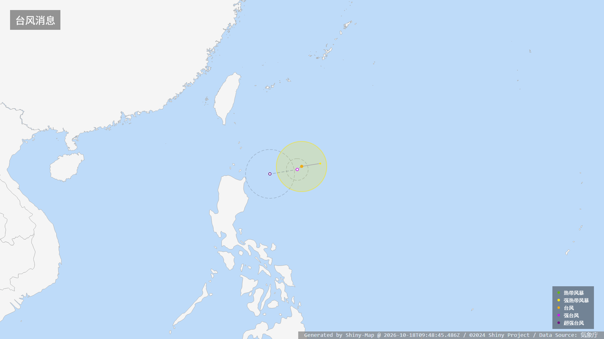
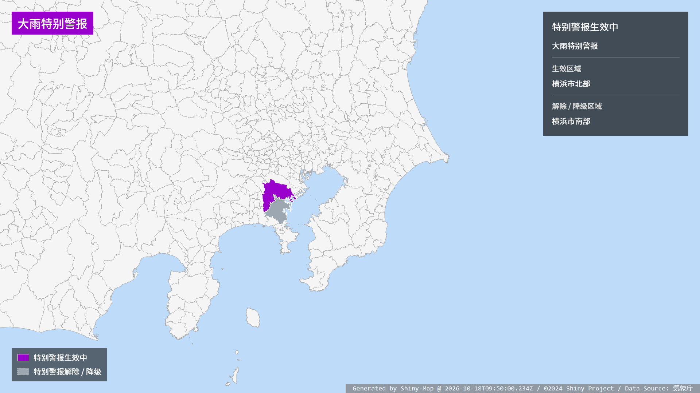

# Shiny-Map 接口文档

## 高亮城市

`GET /Map/highlight`

对中国大陆的城市进行高亮标识。

**参数**

| 参数名 | 参数类型 | 参数说明             |
| ------ | -------- | -------------------- |
| center | string   | 作为地图中心的省份名 |
| cities | string[] | 需要高亮的城市       |

对任何含有省份或城市名的参数，请使用完整官方名称。

**支持省份**

| #   | 省名   |
| --- | ------ |
| 1   | 浙江省 |
| 2   | 上海市 |
| 3   | 江苏省 |

☆ 对于直辖市无法细分

不支持的西南省份返回 `HTTP 451`。

**示例**

`GET /Map/highlight?center=浙江省&cities=["杭州市", "宁波市"]`

---

## 震度速报

`POST /Map/shindo_early_report`

**参数**

| 参数名 | 参数类型 | 参数说明 |
| ------ | -------- | -------- |
| shindo | object   | 震度信息 |

对 `shindo` 参数详细定义如下：

```JavaScript
const shindo = {
    "1": ["震度1的地区"],
    "2": ["震度2的地区"],
    "3": ["震度3的地区"],
    "4": ["震度4的地区"],
    "5-": ["震度5-的地区"],
    "5+": ["震度5+的地区"],
    "6-": ["震度6-的地区"],
    "6+": ["震度6+的地区"],
    "7": ["震度7的地区"],
}
```

其中地区名按照 JMA 震度速报[规范](https://www.data.jma.go.jp/svd/eqev/data/joho/shindo-name.html)规定的地域名填写。

-   数字使用全角数字。例如：`東京都２３区`。

**预览**


---

## 各地区震度信息

`POST /Map/shindo_report`

**参数**

| 参数名    | 参数类型 | 参数说明   |
| --------- | -------- | ---------- |
| epicenter | number[] | 震中经纬度 |
| shindo    | object   | 震度信息   |

定义同上

震中经纬度`epicenter`应为两个浮点数组成的数组。示例：`[140.113, 23.019]`。

其中地区名按照 JMA 各地区震度信息规范规定的地域名填写。

相关规范请参考：

[気象庁防災情報 XML フォーマット　技術資料](http://xml.kishou.go.jp/tec_material.html)

地震火山関連コード表.xls -> Sheet 24 (AreaForecastLocalE ・ AreaInformationCity ・ PointSeismicIntensity コード表)

**预览**


---

## 海啸警报

`POST /Map/tsunami_warning`

**参数**

| 参数名  | 参数类型 | 参数说明 |
| ------- | -------- | -------- |
| type    | string   | 类型     |
| warning | object   | 警报信息 |

类型固定为`warning`（警报发布或更新）或者`cancel`（取消）。值为`cancel`时会忽略`warning`参数的内容。

对警报信息详细定义如下

```JavaScript
const warning = {
    "notice": ["京都府"], // 海啸注意报的区域
    "warning": ["有明・八代海"], // 海啸警报的区域
    "alert": ["千葉県九十九里・外房"] // 大海啸警报的区域
}
```

其中区域名按照 JMA 规定的海啸警报区域名填写。

**预览**


---

## 台风路径信息

`POST /Map/typhoon_info`

**参数**

| 参数名       | 参数类型 | 参数说明 |
| ------------ | -------- | -------- |
| typhoon_info | object   | 台风信息 |

对`typhoon_info`定义如下：

```TypeScript
interface TyphoonInfo {
    /** 特殊状态文本，如台风消散等 */
    remark?: string;
    /** 台风路径点合集，当remark有值时被忽略 */
    points?: Point[];
}

interface Point {
    /** 路径点类型 1: 历史路径点, 2: 当前路径点, 3: 预报路径点 */
    type: number;
    /** 坐标经纬度，格式为[东经, 北纬]，负值相应表示西经和南纬 */
    coordinate: [number, number];
    /** 台风强度 1: 热带风暴, 2: 强热带风暴, 3: 台风, 4: 强台风, 5: 超强台风 */
    intensity: number;
    /** 当前点可提供强风/暴风域，预报点可提供误差圈 */
    circles?: Circle[];
}

interface Circle {
    /** 范围类型 1: 强风域, 2: 暴风域, 3: 预报误差圈（仅用于 type: 3 的路径点） */
    type: number;
    /** 半径，单位为米 */
    radius: number;
    /**
     * 方向 1: 全域, 2: 北, 3: 东北, 4: 东, 5: 东南, 6: 南, 7: 西南, 8: 西, 9: 西北
     * 1 为整圆 其余为半圆
     * 风圈省略时默认为全域；预报误差圈始终为整圆，忽略此字段
     */
    direction?: number;
}
```

路径点按时间先后排列。预报误差圈通过预报点的 `circles` 字段提供，未提供时不显示误差圈。

例如：

```json
{
    "points": [
        { "type": 1, "coordinate": [127.5, 19.4], "intensity": 2 },
        {
            "type": 2,
            "coordinate": [126.2, 19.2],
            "intensity": 3,
            "circles": [{ "type": 1, "radius": 200000 }]
        },
        {
            "type": 3,
            "coordinate": [125.9, 19.0],
            "intensity": 4,
            "circles": [{ "type": 3, "radius": 80000 }]
        },
        {
            "type": 3,
            "coordinate": [124.0, 18.7],
            "intensity": 5,
            "circles": [{ "type": 3, "radius": 180000 }]
        }
    ]
}
```

**预览**



## JMA 气象特别警报（EW）

`POST /Map/ew`，别名 `POST /Map/emergency_warning`。

### 请求参数

`warning` 为特别警报信息对象，字段如下：

| 字段 | 类型 | 默认值 | 说明 |
| --- | --- | --- | --- |
| `active` | `Record<string, string[]>` | `{}` | 生效区域；键为特别警报种类代码，值为区域代码数组 |
| `ended` | `Record<string, string[]>` | `{}` | 已解除 / 降级区域；结构同 `active` |
| `status` | string | `通常` | `通常`：无标记；`訓練`：训练标记；`試験`：试验标记 |
| `infoType` | string | `発表` | `発表`：普通标题；`訂正`：订正标题；`取消`：电文取消标题 |

区域代码为七位 JMA 气象警报 `AreaInformationCity` 字符串，例如横滨市北部 `1410011`、南部 `1410012`。
同一区域有多种警报时，可在多个种类中填写；同时存在生效与解除警报时，两组信息均会显示。
`infoType: "取消"` 时，通过 `ended` 提供取消电文涉及的区域。
`active` 和 `ended` 均为空时显示无特别警报信息。

#### 特别警报种类代码

| 代码 | 类型 |
| --- | --- |
| `32` | 暴风雪特别警报 |
| `33` | 大雨特别警报 |
| `35` | 暴风特别警报 |
| `36` | 大雪特别警报 |
| `37` | 波浪特别警报 |
| `38` | 高潮特别警报 |
| `39` | 土砂灾害特别警报 |

### 请求示例

```http
POST /Map/ew
Content-Type: application/json
```

```json
{
  "warning": {
    "active": { "33": ["1410011"] },
    "ended": { "33": ["1410012"] }
  }
}
```

### 返回值

成功：HTTP 200，返回 1920 × 1080 PNG 的绝对路径。

```json
{
  "path": "D:/Git/Shiny-Map/output/ew_00000000-0000-0000-0000-000000000000.png"
}
```

| HTTP 状态 | `error.name` | 说明 |
| --- | --- | --- |
| 400 | `bad_ew` | 参数格式、警报种类或区域代码错误 |
| 500 | `try_again_later` | 渲染器尚未就绪 |
| 500 | `map_render_failed` | 图片生成失败 |

### 预览



## Special Thanks

我们感谢 @9SQ 开源的震度图生产样例及坐标数据。（ https://github.com/9SQ/seismic-intensity-map ）

We would like to give a special thank to seismic intensity map demo and geographic coordinates which is open sourced by @9SQ.

我们同样需要感谢 Gehirn 和他们旗下的社交网络账号 @UN_NERV 为我们提供了参考和灵感。

Thanks for Gehirn Inc., and their SNS account @UN_NERV who provide much references and inspiration for us.
