# Shiny-Map 接口文档

## 高亮城市

`GET /Map/highlight`

对中国大陆的城市进行高亮标识。

**参数**

| 参数名 | 参数类型 | 参数说明             |
| ------ | -------- | -------------------- |
| center | string   | 作为地图中心的省份名 |
| cities | string[] | 需要高亮的城市       |

对任何含有省份或城市名的参数，请使用完整官方名称。

**支持省份**

| #   | 省名   |
| --- | ------ |
| 1   | 浙江省 |
| 2   | 上海市 |
| 3   | 江苏省 |

☆ 对于直辖市无法细分

不支持的西南省份返回 `HTTP 451`。

**示例**

`GET /Map/highlight?center=浙江省&cities=["杭州市", "宁波市"]`

---

## 地震速报

`POST /Map/earthquake`

生成 1920 × 1080 的地震速报图片。

**参数**

| 参数名 | 参数类型 | 参数说明 |
| --- | --- | --- |
| earthquake | object / JSON string | 地震数据 |

`earthquake` 字段：

| 字段名 | 类型 | 说明 |
| --- | --- | --- |
| content | string | `M 震级 - 地点` 格式的标题，如 `M 6.3 - 197 km NW of Port-Olry, Vanuatu`；地点可仅含地区名 |
| location | string | GeoRSS 坐标，顺序为 `纬度 经度`，如 `-13.9906 165.5892` |
| depth | number / string | 原始 `georss:elev`，单位米，向上为正；如 `-16000` 将显示为深度 `16 千米` |
| source | string（可选） | 数据来源名称，最多 32 个字符，显示在标题与页脚中 |

**请求示例**

```json
{
    "earthquake": {
        "content": "M 6.3 - 197 km NW of Port-Olry, Vanuatu",
        "location": "-13.9906 165.5892",
        "depth": "-16000",
        "source": "USGS"
    }
}
```

**返回值**

成功返回 `{ "path": "图片绝对路径" }`。无效数据返回 HTTP 400，错误名为 `bad_earthquake`。

**预览**

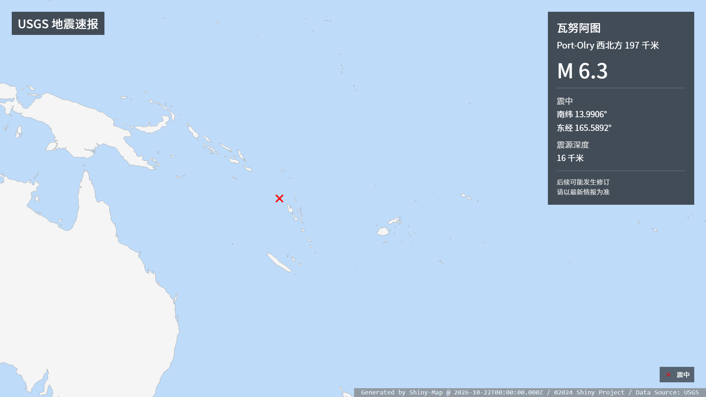

---

## 震度速报

`POST /Map/shindo_early_report`

**参数**

| 参数名 | 参数类型 | 参数说明 |
| ------ | -------- | -------- |
| shindo | object   | 震度信息 |

对 `shindo` 参数详细定义如下：

```JavaScript
const shindo = {
    "1": ["震度1的地区"],
    "2": ["震度2的地区"],
    "3": ["震度3的地区"],
    "4": ["震度4的地区"],
    "5-": ["震度5-的地区"],
    "5+": ["震度5+的地区"],
    "6-": ["震度6-的地区"],
    "6+": ["震度6+的地区"],
    "7": ["震度7的地区"],
}
```

其中地区名按照 JMA 震度速报[规范](https://www.data.jma.go.jp/svd/eqev/data/joho/shindo-name.html)规定的地域名填写。

-   数字使用全角数字。例如：`東京都２３区`。

**预览**


---

## 各地区震度信息

`POST /Map/shindo_report`

**参数**

| 参数名    | 参数类型 | 参数说明   |
| --------- | -------- | ---------- |
| epicenter | number[] | 震中经纬度 |
| shindo    | object   | 震度信息   |

定义同上

震中经纬度`epicenter`应为两个浮点数组成的数组。示例：`[140.113, 23.019]`。

其中地区名按照 JMA 各地区震度信息规范规定的地域名填写。

相关规范请参考：

[気象庁防災情報 XML フォーマット　技術資料](http://xml.kishou.go.jp/tec_material.html)

地震火山関連コード表.xls -> Sheet 24 (AreaForecastLocalE ・ AreaInformationCity ・ PointSeismicIntensity コード表)

**预览**


---

## 海啸警报与预报

`POST /Map/tsunami_warning`

**参数**

| 参数名  | 参数类型 | 参数说明 |
| ------- | -------- | -------- |
| type    | string   | `warning`：发布或更新；`cancel`：解除 |
| warning | object / JSON string | 警报与预报信息 |

对 `warning` 参数详细定义如下：

```JavaScript
const warning = {
    "forecast": ["愛媛県宇和海沿岸"], // 海平面变动（海啸预报）的区域
    "notice": ["京都府"], // 海啸注意报的区域
    "warning": ["有明・八代海"], // 海啸警报的区域
    "alert": ["千葉県九十九里・外房"] // 大海啸警报的区域
}
```

区域填写 JMA 津波预报区名称或三位代码（如 `"600"`）。各等级可省略，同一区域取最高等级。

分组键也可使用 JMA 代码：`71` / `72` / `73`（预报）、`62`（注意报）、`51`（警报）、`52` / `53`（大警报）。

`type: "cancel"` 时，仍有海平面变动的区域通过 `warning.forecast` 提供；未提供预报区域时显示全部解除。

**预览**

| 警报发布 / 更新 | 仅海平面变动 |
| --- | --- |
| 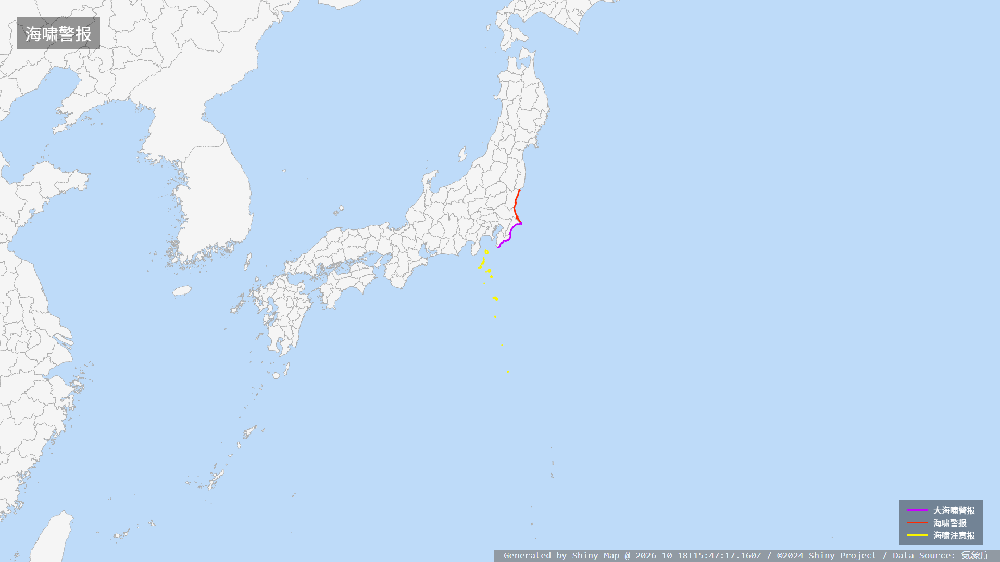 | 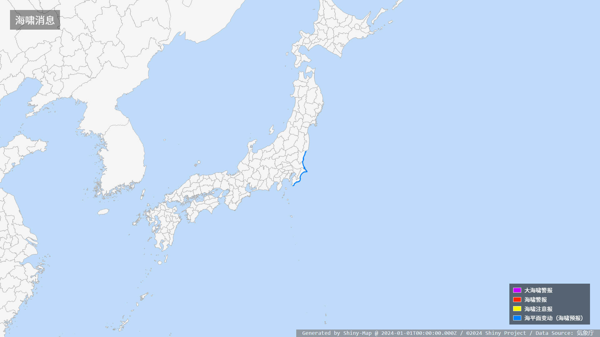 |
| **警报与预报并存** | **全部解除** |
| 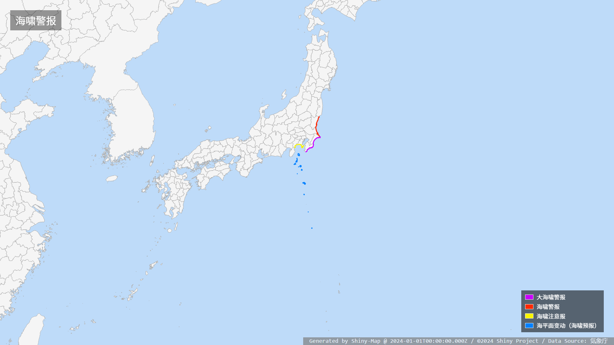 | 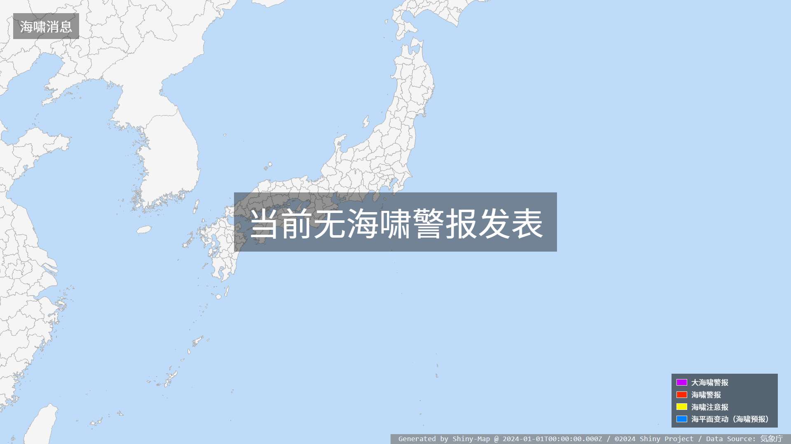 |

---

## 台风路径信息

`POST /Map/typhoon_info`

**参数**

| 参数名       | 参数类型 | 参数说明 |
| ------------ | -------- | -------- |
| typhoon_info | object   | 台风信息 |

对`typhoon_info`定义如下：

```TypeScript
interface TyphoonInfo {
    /** 特殊状态文本，如台风消散等 */
    remark?: string;
    /** 台风路径点合集，当remark有值时被忽略 */
    points?: Point[];
}

interface Point {
    /** 路径点类型 1: 历史路径点, 2: 当前路径点, 3: 预报路径点 */
    type: number;
    /** 坐标经纬度，格式为[东经, 北纬]，负值相应表示西经和南纬 */
    coordinate: [number, number];
    /** 台风强度 1: 热带风暴, 2: 强热带风暴, 3: 台风, 4: 强台风, 5: 超强台风 */
    intensity: number;
    /** 当前点可提供强风/暴风域，预报点可提供误差圈 */
    circles?: Circle[];
}

interface Circle {
    /** 范围类型 1: 强风域, 2: 暴风域, 3: 预报误差圈（仅用于 type: 3 的路径点） */
    type: number;
    /** 半径，单位为米 */
    radius: number;
    /**
     * 方向 1: 全域, 2: 北, 3: 东北, 4: 东, 5: 东南, 6: 南, 7: 西南, 8: 西, 9: 西北
     * 1 为整圆 其余为半圆
     * 风圈省略时默认为全域；预报误差圈始终为整圆，忽略此字段
     */
    direction?: number;
}
```

路径点按时间先后排列。预报误差圈通过预报点的 `circles` 字段提供，未提供时不显示误差圈。

例如：

```json
{
    "points": [
        { "type": 1, "coordinate": [127.5, 19.4], "intensity": 2 },
        {
            "type": 2,
            "coordinate": [126.2, 19.2],
            "intensity": 3,
            "circles": [{ "type": 1, "radius": 200000 }]
        },
        {
            "type": 3,
            "coordinate": [125.9, 19.0],
            "intensity": 4,
            "circles": [{ "type": 3, "radius": 80000 }]
        },
        {
            "type": 3,
            "coordinate": [124.0, 18.7],
            "intensity": 5,
            "circles": [{ "type": 3, "radius": 180000 }]
        }
    ]
}
```

**预览**


## JMA 气象特别警报（EW）

`POST /Map/ew`，别名 `POST /Map/emergency_warning`。

### 请求参数

`warning` 为特别警报信息对象，字段如下：

| 字段 | 类型 | 默认值 | 说明 |
| --- | --- | --- | --- |
| `active` | `Record<string, string[]>` | `{}` | 生效区域；键为特别警报种类代码，值为区域代码数组 |
| `ended` | `Record<string, string[]>` | `{}` | 已解除 / 降级区域；结构同 `active` |
| `status` | string | `通常` | `通常`：无标记；`訓練`：训练标记；`試験`：试验标记 |
| `infoType` | string | `発表` | `発表`：普通标题；`訂正`：订正标题；`取消`：电文取消标题 |

区域代码为七位 JMA 气象警报 `AreaInformationCity` 字符串，例如横滨市北部 `1410011`、南部 `1410012`。
同一区域有多种警报时，可在多个种类中填写；同时存在生效与解除警报时，两组信息均会显示。
`infoType: "取消"` 时，通过 `ended` 提供取消电文涉及的区域。
`active` 和 `ended` 均为空时显示无特别警报信息。

#### 特别警报种类代码

| 代码 | 类型 |
| --- | --- |
| `32` | 暴风雪特别警报 |
| `33` | 大雨特别警报 |
| `35` | 暴风特别警报 |
| `36` | 大雪特别警报 |
| `37` | 波浪特别警报 |
| `38` | 高潮特别警报 |
| `39` | 土砂灾害特别警报 |

### 返回值

成功：HTTP 200，返回 1920 × 1080 PNG 的绝对路径。

```json
{
  "path": "D:/Git/Shiny-Map/output/ew_00000000-0000-0000-0000-000000000000.png"
}
```

| HTTP 状态 | `error.name` | 说明 |
| --- | --- | --- |
| 400 | `bad_ew` | 参数格式、警报种类或区域代码错误 |
| 500 | `try_again_later` | 渲染器尚未就绪 |
| 500 | `map_render_failed` | 图片生成失败 |

### 预览

以下均为模拟数据。紫色表示特别警报生效，灰色虚线边界表示解除 / 降级。

| 单种特别警报生效 | 多种特别警报并存 |
| --- | --- |
| 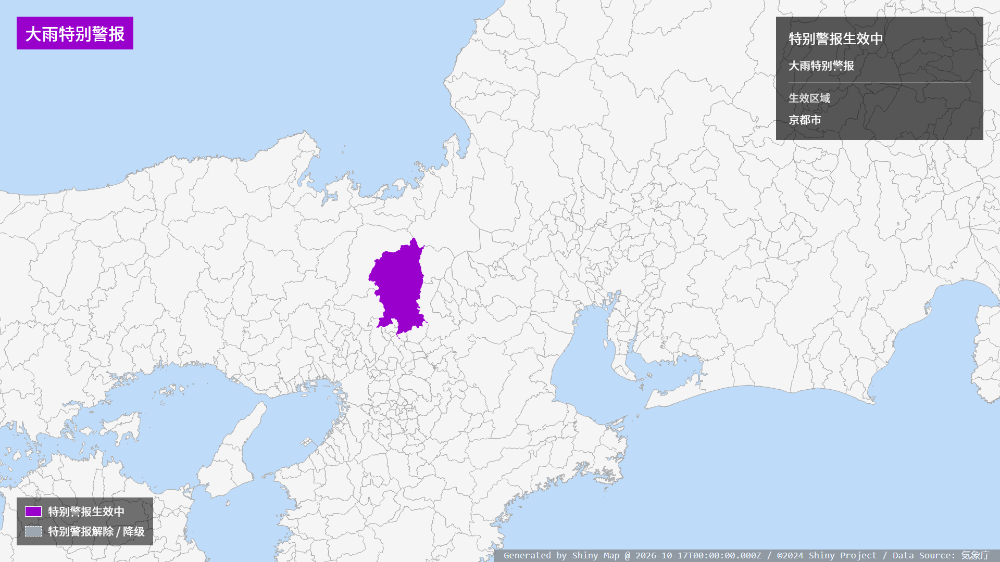<br>京都市的大雨特别警报生效。 | 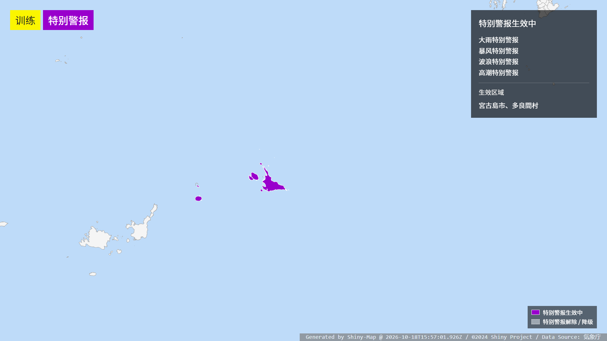<br>多个区域涉及多种特别警报，右侧列出警报种类。 |
| **部分区域解除** | **所列特别警报全部解除 / 降级** |
| <br>横滨市北部仍生效，南部已解除 / 降级。 | 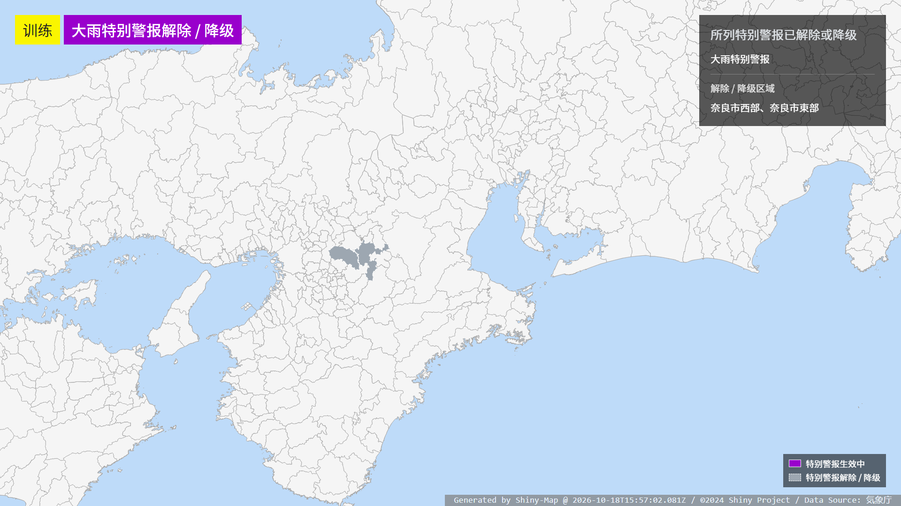<br>奈良市西部和东部均已解除 / 降级，区域显示为灰色。 |

## JMA 喷火警报与预报（VFVO50）

`POST /Map/volcano_warning`

**参数**

| 参数名 | 参数类型 | 参数说明 |
| --- | --- | --- |
| warning | object / JSON string | 火山状态、市町村警报和防灾应对 |

对 `warning` 参数详细定义如下：

| 字段 | 类型 | 默认值 | 说明 |
| --- | --- | --- | --- |
| `volcano.code` | string | 必填 | JMA 三位火山代码，例如浅间山 `"306"` |
| `volcano.coordinate` | number[] / string | 按火山代码定位 | 可选，传入时覆盖默认位置。支持 `[经度, 纬度]` 或 JMA 度分坐标字符串，例如 `"+3624.38+13831.38+2568/"` |
| `volcano.kind` | string | 必填 | 当前火山状态代码，见下表 |
| `areas` | object[] | `[]` | 市町村警报，格式为 `[{ "code": "市町村代码", "kind": "警报代码" }]` |
| `responses` | object[] | `[]` | 市町村防灾应对，格式为 `[{ "code": "市町村代码", "kind": "应对代码", "condition": "状态（可选）" }]` |
| `status` | string | `通常` | `通常`：无标记；`訓練`：训练标记；`試験`：试验标记 |
| `infoType` | string | `発表` | `発表`：普通标题；`訂正`：订正标题；`取消`：电文取消标题 |

`areas` 和 `responses` 中的 `code` 为七位 JMA 火山关系市町村代码，例如箱根町 `"1438200"`。所有代码均使用字符串。

`volcano.code` 为 `"900"`、`"901"`、`"902"` 时没有固定位置，需提供 `volcano.coordinate`。

**种类代码**

| 分组 | `kind` | 含义 |
| --- | --- | --- |
| 火山 | `11`～`15` | 警戒等级 1～5，依次为留意活火山、火口周边管制、限制进山、老年人等避难、避难 |
| 火山 | `21`、`22`、`23`、`24`、`25` | 依次为留意活火山、火口周边危险、进山危险、山麓严格警戒、居住区严格警戒 |
| 火山 | `35`、`36` | 留意海底活火山、周边海域警戒 |
| 市町村警报（`areas`） | `01`、`02`、`03` | 喷火警报、火口周边警报、喷火警报（周边海域） |
| 市町村警报（`areas`） | `04`、`05` | 喷火预报：警报解除、喷火预报 |
| 防灾应对（`responses`） | `41` | 喷火警报：避难等 |
| 防灾应对（`responses`） | `42`、`43` | 喷火警报：限制进山等、火口周边警报：限制进山等 |
| 防灾应对（`responses`） | `44`、`45` | 周边海域警戒、留意活火山 |
| 防灾应对（`responses`） | `46`、`47` | 居住区严格警戒、山麓严格警戒 |
| 防灾应对（`responses`） | `48`、`49` | 喷火警报：火口周边警戒、火口周边警报：火口周边警戒 |

`responses[].condition` 可省略，支持 `発表`、`引上げ`、`切替`、`継続`、`引下げ`、`解除`。`kind: "45"` 的应对解除时填写 `condition: "解除"`。

警报解除使用 `areas[].kind: "04"`。`infoType: "取消"` 用于取消电文，仍需提供涉及的火山及区域。

**示例**

```json
{
    "warning": {
        "status": "試験",
        "volcano": {
            "code": "306",
            "kind": "13"
        },
        "areas": [
            { "code": "1042500", "kind": "02" }
        ],
        "responses": [
            { "code": "1042500", "kind": "43" }
        ]
    }
}
```

成功返回 `{ "path": "图片绝对路径" }`，图片为 1920 × 1080 PNG。

**预览**

| 火口周边警报 | 喷火特别警报 |
| --- | --- |
| 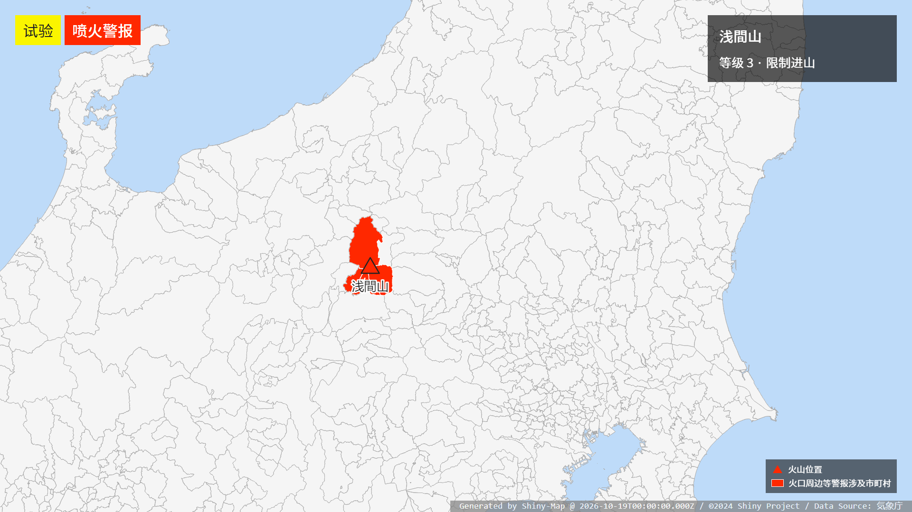 | 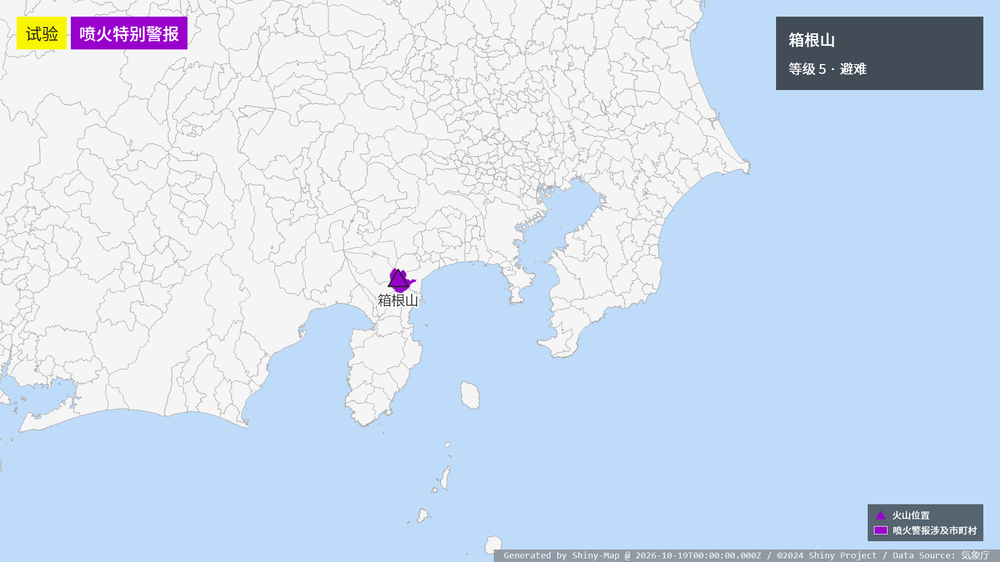 |
| **警报解除** | **海底火山** |
| 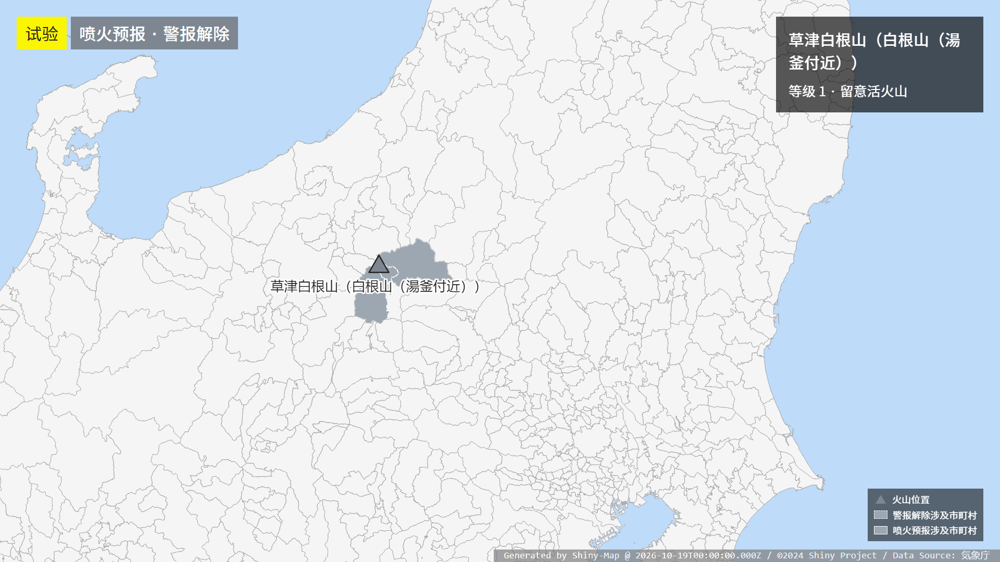 | 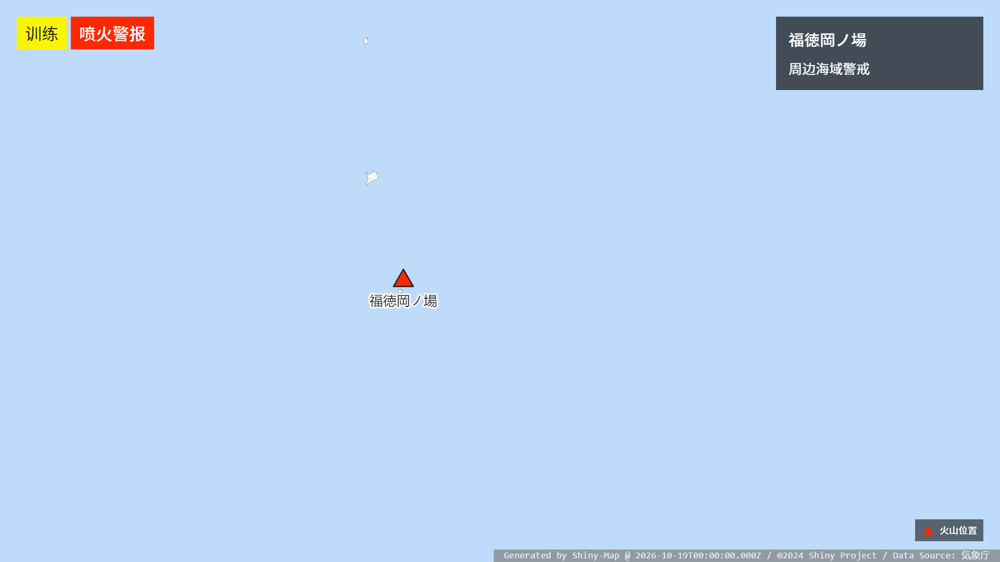 |

## JMA 指定河川洪水情报（VXKO）

`POST /Map/flood_warning`

**参数**

| 参数名 | 参数类型 | 参数说明 |
| --- | --- | --- |
| warning | object / JSON string | 河川预报区及洪水情报状态 |

对 `warning` 参数详细定义如下：

| 字段 | 类型 | 默认值 | 说明 |
| --- | --- | --- | --- |
| `rivers` | object[] | 必填 | 非空河川预报区数组，每项格式见下方 |
| `rivers[].code` | string | 必填 | JMA 十二位河川预报区代码，例如小矢部川 `"840410000100"`；自动显示名称 |
| `rivers[].kind` | string | 必填 | 洪水情报种类代码，见下表 |
| `rivers[].areas` | string[] | 按河川预报区查找 | 可选，覆盖默认涉及市町村，例如 `["1620200", "1620800"]` |
| `rivers[].occurredAreas` | string[] | `[]` | L5 泛滥发生信息涉及市町村，使用橙色边界标记；自动加入绘图范围 |
| `status` | string | `通常` | `通常`：无标记；`訓練`：训练标记；`試験`：试验标记 |
| `infoType` | string | `発表` | `発表`：普通标题；`訂正`：订正标题；`取消`：电文取消标题 |

所有代码均使用字符串。`code` 使用电文 `Headline` 中 `指定河川洪水予報（予報区域）` 的十二位代码。
`areas`、`occurredAreas` 使用七位指定河川洪水预报市町村代码，可分别填写电文 `Body/Warning` 中种类代码 `1`、`2` 的 `CityCode`。

填色表示情报涉及市町村，不能作为实际淹水范围。同一市町村涉及多个河川时，优先显示最高生效等级。
`occurredAreas` 仅用于 L5；未提供时不显示泛滥发生标记。

**种类代码**

| `kind` | 含义 |
| --- | --- |
| `10` | L2 泛滥注意报解除 |
| `20`、`21` | L2 泛滥注意报：发布、继续 |
| `22` | 警报解除，降为 L2 泛滥注意报，仍生效 |
| `30`、`31` | L3 泛滥警报：发布、继续 |
| `40`、`41` | L4 泛滥危险警报：发布、继续 |
| `51` | L5 泛滥特别警报 / 泛滥发生信息 |
| `53` | L5 泛滥特别警报（泛滥水预报） |

`kind: "10"` 显示为灰色虚线边界。`infoType: "取消"` 用于取消电文，仍需提供涉及的河川预报区。

**示例**

```json
{
    "warning": {
        "status": "試験",
        "rivers": [
            { "code": "840410000100", "kind": "20" }
        ]
    }
}
```

L5 泛滥发生信息可填写 `{ "code": "820211000103", "kind": "51", "occurredAreas": ["0636700"] }`。

成功返回 `{ "path": "图片绝对路径" }`，图片为 1920 × 1080 PNG。参数错误返回 HTTP 400，`error.name` 为 `bad_flood`。

**预览**

以下采用 JMA 官方样例并添加试验标记。

| L2 泛滥注意报 | L3 泛滥警报 |
| --- | --- |
| 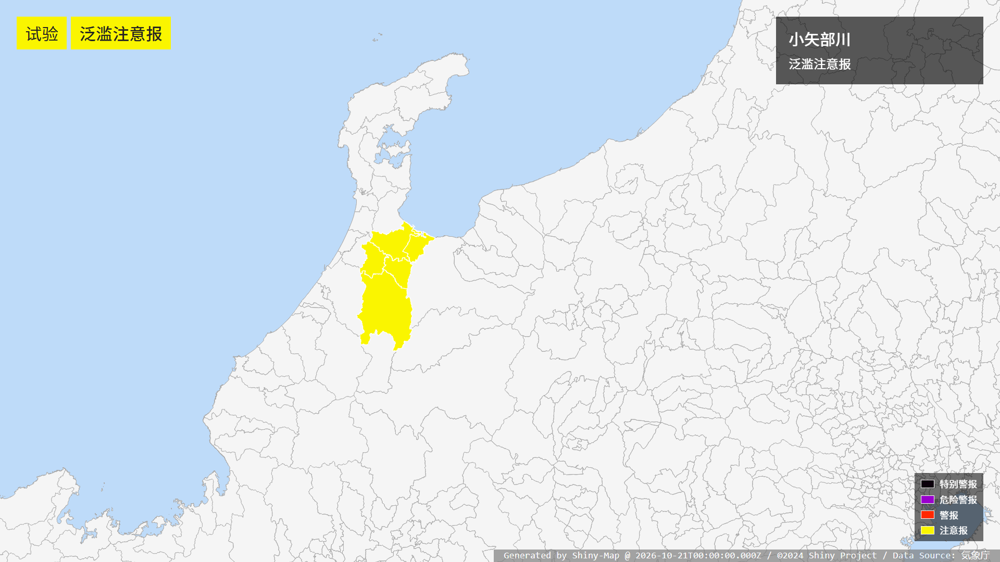 | 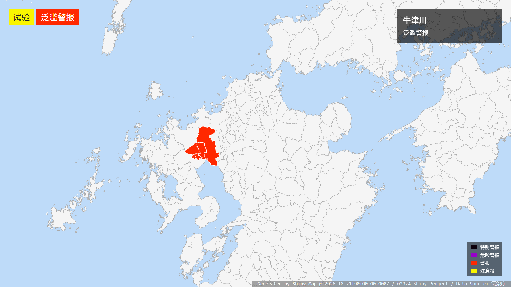 |
| **L4 泛滥危险警报** | **L5 泛滥特别警报及泛滥发生信息** |
| 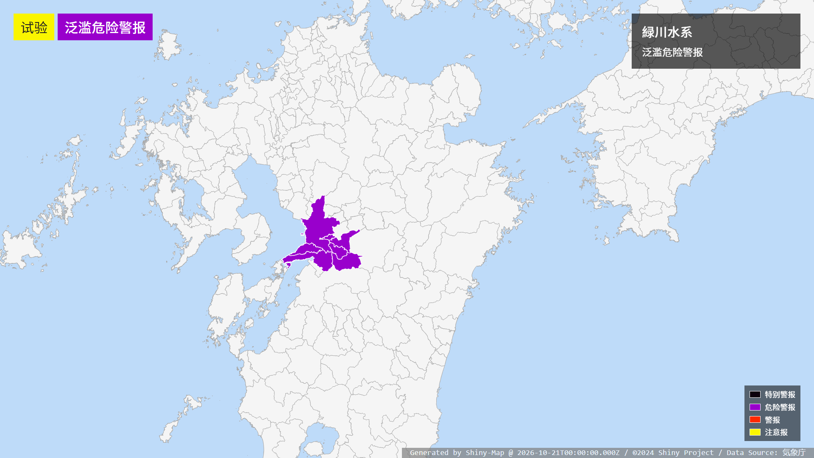 | 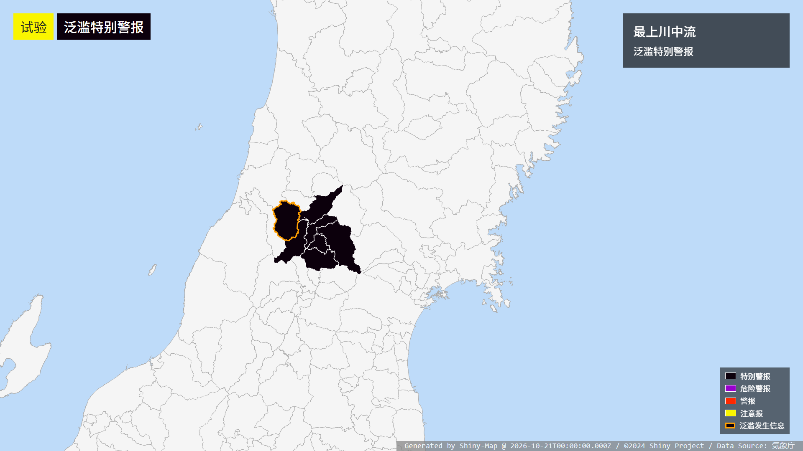 |

## Special Thanks

我们感谢 @9SQ 开源的震度图生产样例及坐标数据。（ https://github.com/9SQ/seismic-intensity-map ）

We would like to give a special thank to seismic intensity map demo and geographic coordinates which is open sourced by @9SQ.

我们同样需要感谢 Gehirn 和他们旗下的社交网络账号 @UN_NERV 为我们提供了参考和灵感。

Thanks for Gehirn Inc., and their SNS account @UN_NERV who provide much references and inspiration for us.
